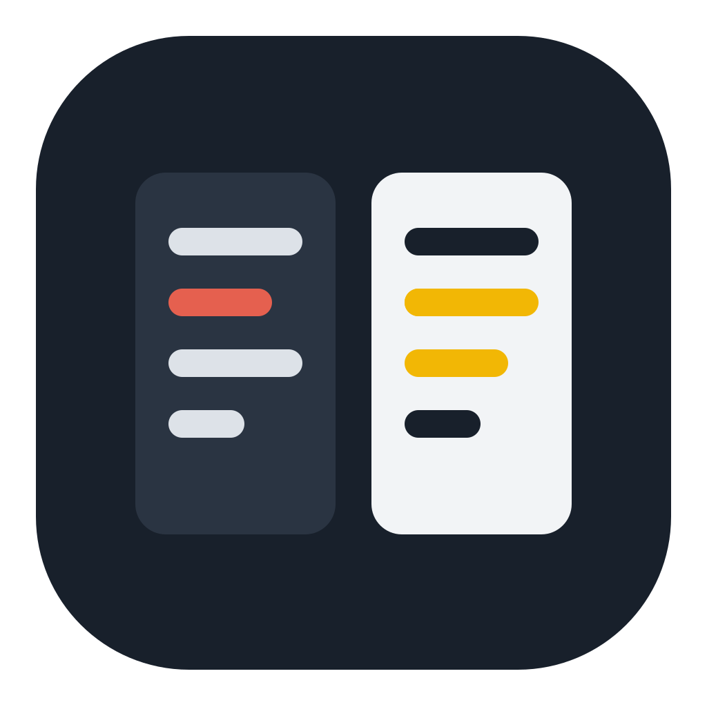
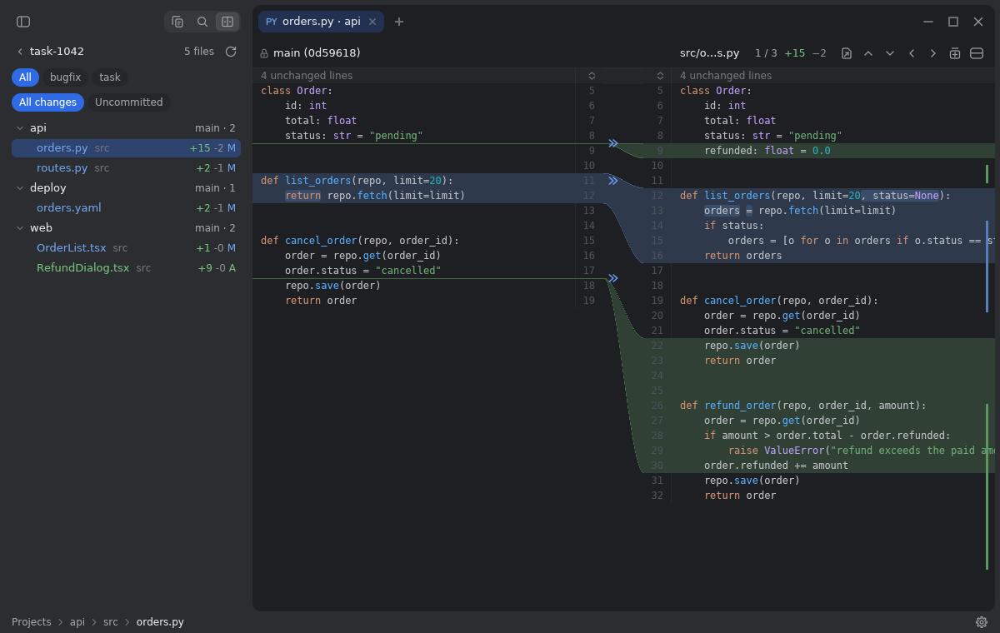

<div align="center">
  
  <h1>Differ</h1>
  <p><b>一个任务，多个仓库，一次看完改动</b></p>
  <p>中文 · <a href="README_EN.md">English</a></p>
  <a href="https://github.com/goodboykeeny/Differ/releases"></a>
  <a href="rust-toolchain.toml"></a>
  <a href="LICENSE"></a>
</div>

## 简介

一个需求往往同时改到后端、前端和部署配置，改动散在几个仓库里，审阅时要在几个窗口之间来回切换。

Differ 是一款桌面应用，按分支名把本地各仓库的工作树归到同一个任务下：几个项目都检出了 `task-1042`，它们的改动文件就列在同一处，点开即是左右并排的差异。

## 界面预览

<p align="center">
  
</p>

<p align="center"><sub>任务 <code>task-1042</code> 改了 api、deploy、web 三个项目的 5 个文件，都在同一个侧栏里。</sub></p>

## 功能

- **按任务归组**：扫描打开的目录、它的直属子目录和其中的 `.worktrees/`，以及已发现仓库登记的其他工作树，检出同名分支的项目归到同一个任务
- **两种范围**：「全部改动」看任务从基线分支分出后的全部改动，「未提交」只看工作区里还没提交的部分
- **跨项目连续审阅**：上一个、下一个文件都在同一个差异标签页里切换，换到另一个项目也不用重新打开
- **差异里看 Blame**：在任务差异的工作区一侧显示逐行 Blame，点击某一行跳到该项目日志中对应的提交
- **两套主题**：Graphite Night 是中性深灰配蓝色强调，Graphite Day 是暖白纸色配藏青强调和衬线界面字体

## 安装

安装包随版本发布在 [Releases](https://github.com/goodboykeeny/Differ/releases) 页，下载对应系统的文件即可。

也可以从源码运行，先装好 Git 和 [Rust](https://rustup.rs/)（macOS 另需 Xcode 命令行工具），工具链版本由 [`rust-toolchain.toml`](rust-toolchain.toml) 指定：

```sh
git clone --branch dev https://github.com/goodboykeeny/Differ.git
cd Differ
cargo run --locked --release -- "$HOME/Projects"
```

把 `"$HOME/Projects"` 换成存放各个仓库的目录，编译出的可执行文件是 `target/release/differ`。

## 使用

1. 打开存放各项目的目录，在侧栏选择「任务」
2. 选一个任务分支，例如 `task-1042`，改动文件按项目分组列出，可用关键词按钮筛选任务
3. 点击文件查看并排差异，用上一个、下一个按钮顺着审完整个任务

| 范围 | 比较对象 | 包含 |
| :--- | :--- | :--- |
| **全部改动** | 工作区与最近基线分支的合并基点 | 已提交和未提交的改动 |
| **未提交** | 工作区与 `HEAD` | 已暂存、未暂存和未跟踪的文件 |

找不到可用的基线分支时，「全部改动」先尝试上游分支，再回退到 `HEAD`。

## 配置

默认扫描当前打开的目录。想固定扫描目录、筛选关键词或基线分支，在配置文件里加一段 `tasks`：

```json
{
  "tasks": {
    "roots": ["~/Projects"],
    "keywords": ["bugfix", "task"],
    "baselines": ["master", "main", "develop", "dev", "release-*"]
  }
}
```

| 字段 | 作用 | 不设置时 |
| :--- | :--- | :--- |
| `roots` | 扫描哪些目录 | 扫描当前打开的目录 |
| `keywords` | 任务列表上方的筛选按钮 | `bugfix` 和 `task` |
| `baselines` | 用来比较的基线分支，不出现在任务列表里，`*` 匹配任意字符序列 | 内置的一组常见主干分支名 |

配置文件的位置：

| 系统 | 路径 |
| :--- | :--- |
| macOS | `~/Library/Application Support/differ/config.json` |
| Windows | `%APPDATA%\differ\config.json` |
| Linux | `~/.config/differ/config.json` |

## 致谢

Differ 基于 [Winc](https://github.com/DEEIX-AI/Winc) 编辑器开发，编辑、终端、Git 日志等能力都来自它，Differ 在其上加了任务视图。

## 授权条款

[Apache License 2.0](LICENSE)，版权和第三方声明见 [NOTICE](NOTICE)。
