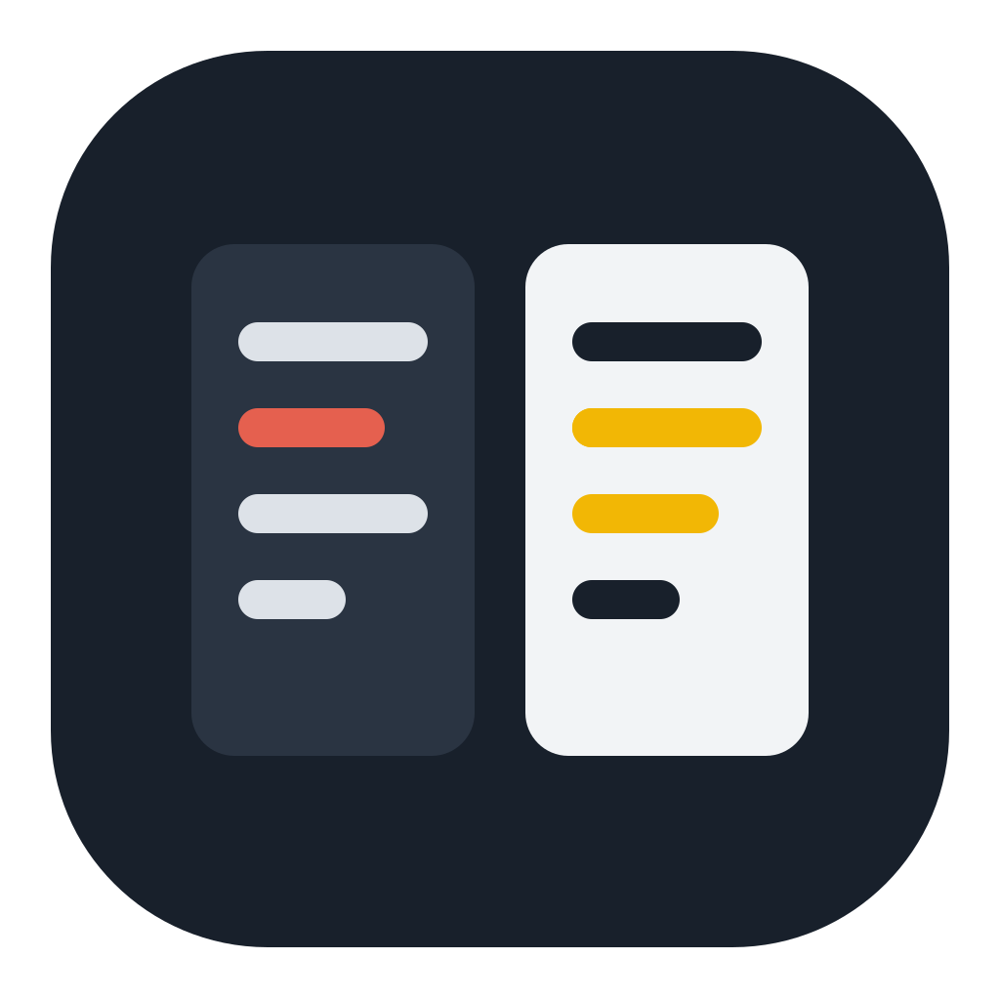
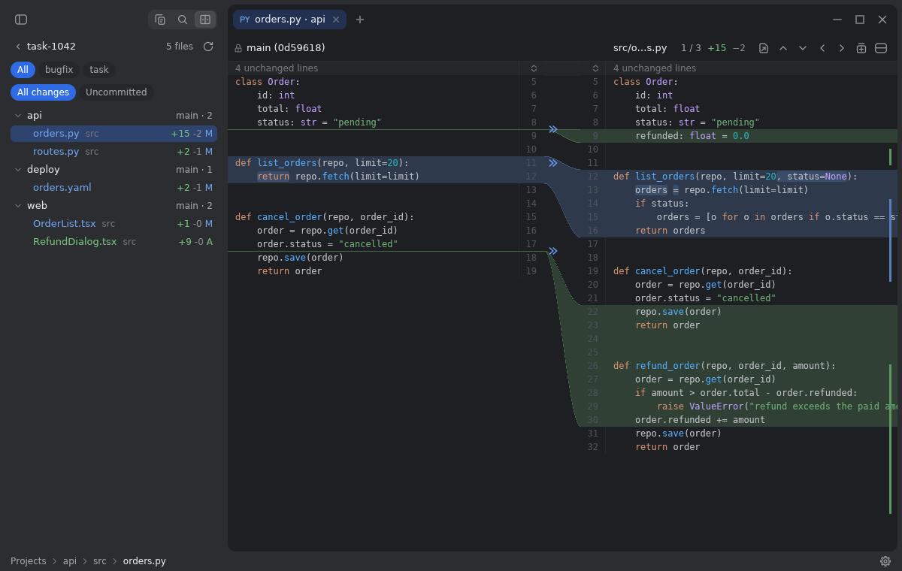
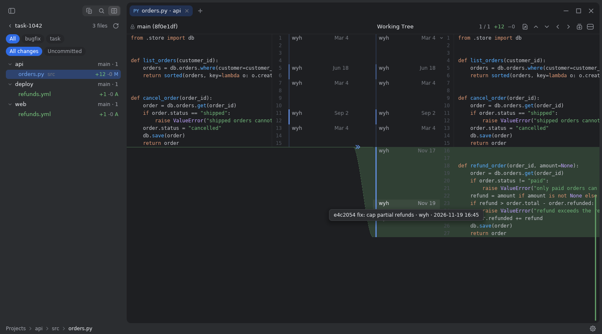

<div align="center">
  
  <h1>Differ</h1>
  <p><b>One task, several repositories, one place to review the changes</b></p>
  <p><a href="README.md">中文</a> · English</p>
  <a href="https://github.com/goodboykeeny/Differ/releases"></a>
  <a href="rust-toolchain.toml"></a>
  <a href="LICENSE"></a>
</div>

## About

A single task often touches a backend, a frontend, and a deployment repository. The changes end up spread across several repositories, and reviewing them means switching between windows.

Differ is a desktop app that groups local Git worktrees into one task by branch name. When several projects have `task-1042` checked out, their changed files are listed in one place, and selecting a file opens its side-by-side diff.

## Preview

<p align="center">
  
</p>

<p align="center"><sub>Task <code>task-1042</code> changes 5 files in three projects (api, deploy, web), all listed in one sidebar.</sub></p>

<p align="center">
  
</p>

<p align="center"><sub>Right-click in a diff to turn on blame: each side gets an author and date column, hover shows the commit, and a click opens it in the log.</sub></p>

## Features

- **Grouped by task**: scans the open folder, its immediate subfolders and their `.worktrees/` directories, plus the linked worktrees of every repository it finds. Projects with the same branch checked out form one task
- **Two ranges**: **All changes** shows everything since the task branched off its baseline, **Uncommitted** shows only what is not committed yet
- **Review across projects**: next and previous file stay in the same diff tab, even when the next file belongs to another project
- **Blame in the diff**: shows line-by-line blame on the working-tree side of a task diff, and selecting a row opens that commit in the project's log
- **Two themes**: Graphite Night is a neutral dark grey with a blue accent, Graphite Day is a warm paper white with a navy accent and a serif interface font

## Install

Installers for each system are published on the [Releases](https://github.com/goodboykeeny/Differ/releases) page.

To run from source, install Git and [Rust](https://rustup.rs/) (plus the Xcode Command Line Tools on macOS). The toolchain version is pinned in [`rust-toolchain.toml`](rust-toolchain.toml):

```sh
git clone --branch dev https://github.com/goodboykeeny/Differ.git
cd Differ
cargo run --locked --release -- "$HOME/Projects"
```

Replace `"$HOME/Projects"` with the folder that holds your repositories. The built executable is `target/release/differ`.

## Usage

1. Open the folder that holds your projects, then select **Tasks** in the sidebar
2. Select a task branch such as `task-1042`. Its changed files are listed by project, and the keyword buttons filter the task list
3. Select a file to see its side-by-side diff, then step through the whole task with next and previous

| Range | Compares | Includes |
| :--- | :--- | :--- |
| **All changes** | The working tree with the merge base of the nearest baseline branch | Committed and uncommitted changes |
| **Uncommitted** | The working tree with `HEAD` | Staged, unstaged, and untracked files |

When no baseline branch can be used, **All changes** tries the upstream branch, then falls back to `HEAD`.

## Configuration

By default Differ scans the open folder. To fix the scan folders, the filter keywords, or the baseline branches, add a `tasks` section to the config file:

```json
{
  "tasks": {
    "roots": ["~/Projects"],
    "keywords": ["bugfix", "task"],
    "baselines": ["master", "main", "develop", "dev", "release-*"]
  }
}
```

| Field | What it sets | When omitted |
| :--- | :--- | :--- |
| `roots` | The folders to scan | The open folder is scanned |
| `keywords` | The filter buttons above the task list | `bugfix` and `task` |
| `baselines` | The branches used for comparison, which are left out of the task list. `*` matches any sequence of characters | A built-in set of common trunk branch names |

Where the config file lives:

| System | Path |
| :--- | :--- |
| macOS | `~/Library/Application Support/differ/config.json` |
| Windows | `%APPDATA%\differ\config.json` |
| Linux | `~/.config/differ/config.json` |

## Credits

Differ is built on the [Winc](https://github.com/DEEIX-AI/Winc) editor. Editing, the terminal, the Git log and the rest come from Winc, and Differ adds the Tasks view on top.

## License

[Apache License 2.0](LICENSE). See [NOTICE](NOTICE) for copyright and third-party attribution.
